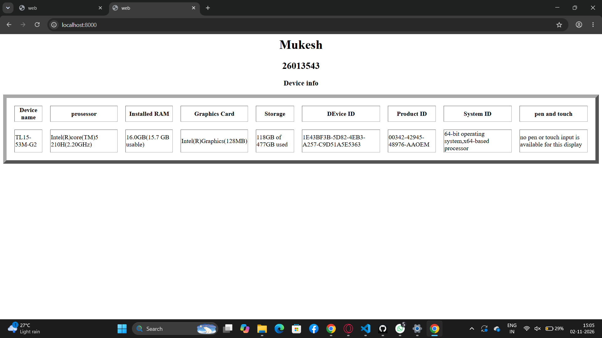
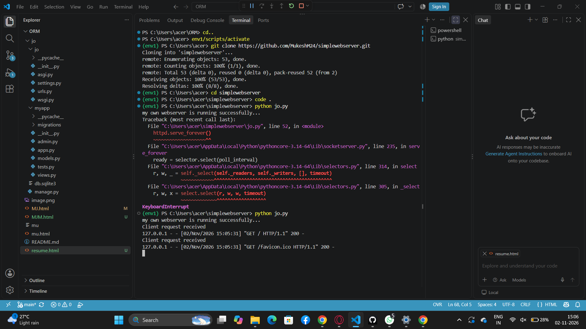

/ EX01 Developing a Simple Webserver
## Date:28/09/2026

## AIM:
To develop a simple webserver to serve html pages and display the Windows Specifications of your Laptop.

## DESIGN STEPS:
### Step 1: 
HTML content creation.

### Step 2:
Design of webserver workflow.

### Step 3:
Implementation using Python code.

### Step 4:
Import the necessary modules.

### Step 5:
Define a custom request handler.

### Step 6:
Start an HTTP server on a specific port.

### Step 7:
Run the Python script to serve web pages.

### Step 8:
Serve the HTML pages.

### Step 9:
Start the server script and check for errors.

### Step 10:
Open a browser and navigate to http://127.0.0.1:8000 (or the assigned port).

## PROGRAM:
```
from http.server import HTTPServer, BaseHTTPRequestHandler
content = """
<html>
    <head>
        <title>web</title>
    </head>
    <body bgcolor="white">
        <center>
        <h1 align="center">Mukesh</h1>
        <h2 align="center">26013543</h2>
        <h3 align="center">Device info</h3>
     <table border="9"celladding="2" cellspacing="20">
        <tr>
            <th>Device name</th>
            <th>prosessor</th>
            <th>Installed RAM</th>
            <th>Graphics Card</th>
            <th>Storage</th>
            <th>DEvice ID</th>
            <th>Product ID</th>
            <th>System ID</th>
            <th>pen and touch</th>
        
        </tr>
        <tr>
            <td>TL15-53M-G2</td>
            <td>Intel(R)core(TM)5 210H(2.20GHz)</td>
            <td>16.0GB(15.7 GB usable)</td>
            <td>Intel(R)Graphics(128MB)</td>
            <td>118GB of 477GB used</td>
            <td>1E43BF3B-5D82-4EB3-A257-C9D51A5E5363</td>
            <td>00342-42945-48976-AAOEM</td>
            <td>64-bit operating system,x64-based processor</td>
            <td>no pen or touch input is available for this display</td>
        </tr>
        
    </table>
        </center>
    </body>
</html>
"""
class myhandler(BaseHTTPRequestHandler):
    def do_GET(self):
        print("Client request received")
        self.send_response(200)
        self.send_header('content-type', 'text/html; charset=utf-8')
        self.end_headers()
        self.wfile.write(content.encode())
server_address = ('',8000)
httpd = HTTPServer(server_address,myhandler)
print("my own webserver is running successfully...")
httpd.serve_forever()
```

## OUTPUT:

serverpage

## RESULT:
The program for implementing simple webserver is executed successfully.
